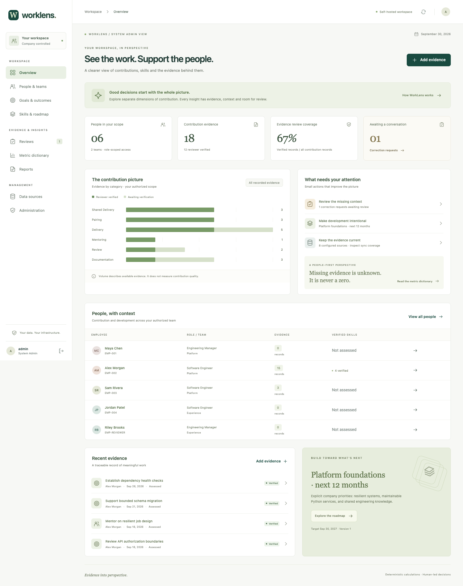

# WorkLens

**Evidence for better development conversations.**

WorkLens is a self-hosted employee contribution, skills and workforce-planning
application for engineering teams. It connects structured work evidence to human
reviews and explicit company roadmaps. It uses deterministic calculations—no AI,
machine learning, embeddings, activity-based productivity scores or employee rankings.

> WorkLens supports human decisions. It does not automate hiring, firing,
> promotion or compensation, and it does not calculate an employee's worth.



## What is included

- React/TypeScript interface with personal/team dashboards, employee profiles,
  evidence, goals, skills matrix, roadmap gaps, reviews and corrections.
- Django REST API, PostgreSQL schema/migrations, local session authentication and
  server-enforced employee, manager, reviewer, integration-admin and system-admin roles.
- Separate Jira, Bitbucket and Confluence Cloud/Data Center adapters, resumable
  database-backed synchronization, identity-resolution review and CSV imports.
- Seven explainable dimensions with versioned formulas, frozen inputs, source
  freshness, sample sizes, missing-data states and evidence links.
- Append-only assessments and correction approvals, authorized CSV/PDF reports,
  audit records, source purging, retention and employee offboarding.
- HTTPS Docker Compose deployment, deny-by-default runtime networking, an optional
  allowlisted egress gateway, encrypted connector credentials and authenticated
  encrypted backup/restore tooling.
- Synthetic demo data, automated API/connector/metric tests, and browser workflow tests.

All frontend assets are bundled locally. There are no runtime analytics, remote
fonts, external storage or hosted authentication dependencies. Work email is an
identity-matching hint; it is never a source-system credential.

## Try the synthetic demo

Requires Python 3.13 and Node 22.12+:

```sh
python3.13 -m venv .venv
.venv/bin/pip install -r requirements.txt
DEBUG=1 .venv/bin/python backend/manage.py migrate
DEBUG=1 .venv/bin/python backend/manage.py seed_demo --password 'WorkLens-demo-2026!'
DEBUG=1 .venv/bin/python backend/manage.py runserver 127.0.0.1:8000
```

In another terminal:

```sh
cd frontend
npm ci
npm run dev
```

Open the Vite URL. Synthetic accounts are `admin`, `manager`, `alex`, `reviewer`
and `integrations`, using the password supplied to `seed_demo`. Existing user
passwords are never reset by reseeding. This public demo password is only for
isolated synthetic evaluation.

Run the worker in a third terminal for queued reports and live synchronization:

```sh
DEBUG=1 .venv/bin/python backend/manage.py run_worker
```

For the full HTTPS/PostgreSQL installation, see [deployment](docs/DEPLOYMENT.md).

## Demonstrate the complete workflow

1. Sign in as `admin`, open Integrations, and test/sync the synthetic fixture.
2. Resolve `demo-alex` to Alex Morgan in identity review. Email matching alone
   leaves identity attribution pending administrator confirmation.
3. Open Alex's profile, calculate metrics and inspect definitions and inputs.
4. Sign in as `alex`, inspect an evidence record and request a context correction.
5. Sign in as `manager`, review the request. The original evidence and dated
   approval addendum both remain available.
6. Export an authorized report. An employee cannot export an unrelated employee.

The same sequence can be exercised against the running local demo:

```sh
.venv/bin/python scripts/smoke_api.py
```

## Run checks

```sh
DEBUG=1 .venv/bin/python backend/manage.py test tests --verbosity 2
.venv/bin/python -m unittest discover -s scripts -p 'test_*.py' -v
cd frontend
npm run build
npx playwright install chromium
npm run test:e2e
```

Browser checks require the seeded backend and frontend running. Production-style
database tests can run with `docker compose run --rm api python manage.py test tests`.
The [verification record](docs/VERIFICATION.md) states what was actually exercised.

## Architecture

```text
Browser ── HTTPS ── nginx + local React assets
                        │
                   Django API ── PostgreSQL
                        │              │
                    shared data ── sync worker
                                       │
                         optional allowlisted gateway
                                       │
                            approved company systems
```

The default runtime network is internal. Source integrations require explicit
source scopes, credentials, application endpoint allowlists and gateway policy.
Unavailable sources do not prevent use of retained synchronized data. Confirmed
revoked access quarantines affected evidence and invalidates derived copies.

| Code | Purpose |
| --- | --- |
| `backend/core` | Organization, permissions, evidence, reviews, metrics and persistence |
| `backend/connectors` | Read-only protocol adapters, fixtures and guarded HTTPS transport |
| `frontend` | Responsive React application and browser tests |
| `deploy` | Pinned container builds, HTTPS and gateway configuration |
| `scripts` | Local configuration, backups, egress probes and HTTP acceptance checks |

## Documentation

- [Administrator and employee guide](docs/USER_GUIDE.md)
- [API reference](docs/API.md)
- [Metric dictionary and worked examples](docs/METRICS.md)
- [Connector support and live verification checklist](docs/CONNECTORS.md)
- [Deployment, upgrades and troubleshooting](docs/DEPLOYMENT.md)
- [Encrypted backups, restoration and deletion](docs/BACKUP_RESTORE.md)
- [Optional company identity provider](docs/IDENTITY_PROVIDER.md)
- [Tests, verification and remaining limitations](docs/VERIFICATION.md)
- [Security boundaries](SECURITY.md)

## Verification boundary

Source adapters are **fixture-tested**, not verified against a live customer tenant.
No production credentials or employee records were used. Supported observations
and deployment-specific limits are listed per connector. No claim of production
readiness, zero leakage, zero data loss or complete air-gap isolation is made.

This implementation deliberately keeps unassessed skills and missing quality
observations unknown. Capacity and work context accompany the evidence; they do
not become hidden productivity multipliers. Cloud-connected integrations remain
cloud-connected even when WorkLens itself is hosted internally.

MIT licensed. See [LICENSE](LICENSE).
